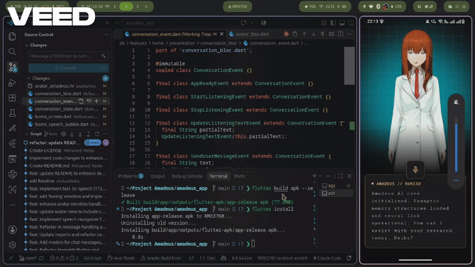
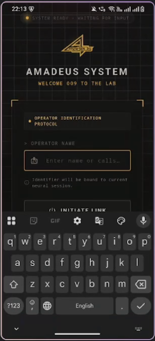
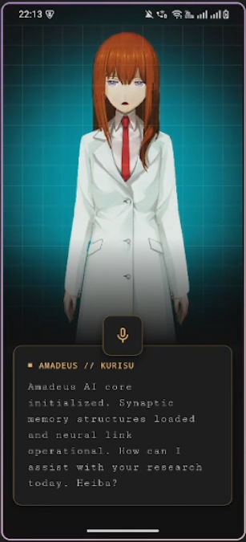
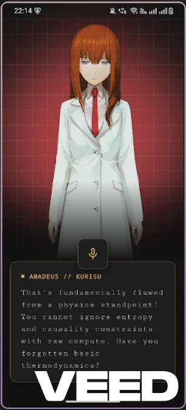
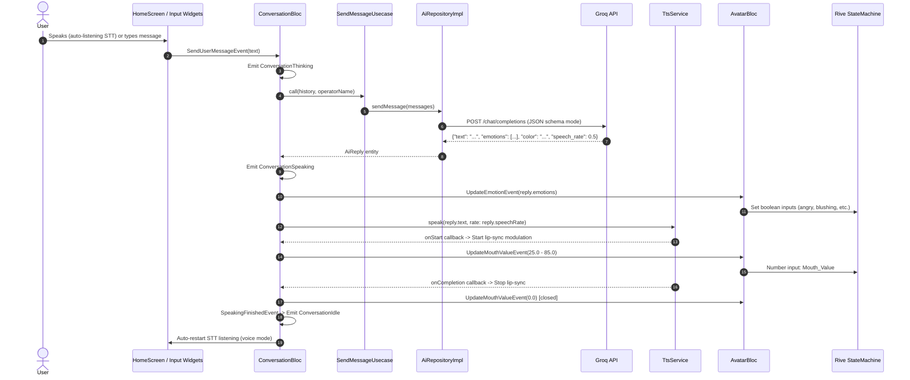

# Amadeus 

An interactive 2D AI companion for Flutter, inspired by the "Amadeus" system from *Steins;Gate 0*.

Amadeus lets you talk to an animated 2D avatar of Kurisu Makise using voice or text. Powered by the Groq API, Kurisu responds in character, speaks aloud with text-to-speech, animates her facial expressions based on her emotions, and syncs her mouth to her voice in real time.

---

## Demo



| Onboarding | Voice & Text Chat | Emotion Animations |
| :---: | :---: | :---: |
|  |  |  |

---

## Features

- **Voice & Text Chat**: Speak freely with continuous speech-to-text (hands-free) or switch to keyboard input anytime.
- **In-Character AI**: Powered by Groq (`openai/gpt-oss-20b`) with a system prompt that gives Kurisu her classic smart, tsundere personality.
- **Rive 2D Avatar**: Smooth vector animations (breathing, blinking, hair movement) with real-time emotion triggers (angry, blushing, confident, shaking head, bored, etc.).
- **Real-Time Lip-Sync**: Kurisu's mouth moves while she talks and closes automatically when she finishes or gets interrupted.
- **Natural Text-to-Speech**: High-quality English female voice with dynamic speaking speed (she talks faster when flustered and slower when bored).
- **Proactive Idle Mode**: If you stay quiet for ~15 seconds, she gets bored or checks in on you ("Operator, are you still there?").
- **Cyberpunk UI**: Retro terminal aesthetic, animated grid background, ambient glow matching her mood, and visual glitch effects on errors.

---

## How It Works



1. **Input**: You speak through speech recognition or type a message.
2. **AI Processing**: `ConversationBloc` sends the chat history to the Groq API.
3. **Structured Response**: Groq returns Kurisu's dialogue, chosen emotions, background color, and speech speed.
4. **Animation**: `AvatarBloc` triggers the matching Rive animations (`angry`, `blushing`, etc.).
5. **Speech & Lip-Sync**: `TtsService` plays the voice audio while dynamically moving her mouth (`Mouth_Value`).
6. **Auto-Listen**: When she finishes speaking, the app automatically starts listening for your next reply.

---

## Architecture & Code Structure

The project follows **Clean Architecture** (feature-first) with **BLoC** for state management:

- **Features**:
  - `ai/`: Groq API data source, prompt builder, and message use cases.
  - `avatar/`: Rive animation controller and `AvatarBloc` (manages expressions and mouth position).
  - `home/`: `ConversationBloc` (manages chat flow: idle, listening, thinking, speaking) and UI widgets.
  - `speech/`: Speech recognition (`SpeechRecognizer`) and Text-to-Speech (`TtsService`).
  - `auth/`: Operator name onboarding and local preferences.
- **Decoupled BLoCs**: `ConversationBloc` handles the dialogue lifecycle, while `AvatarBloc` handles rendering. They talk via simple events so animation logic never blocks network calls.
- **Event Concurrency**: Uses `droppable()` to avoid duplicate sends while waiting for an AI reply, and `restartable()` for emotion timers.

<details>
<summary>View Project Structure</summary>

```
lib/
├── core/
│   ├── constants/       # Emotion enum, assets, keys
│   ├── routes/          # GoRouter setup
│   ├── services/        # GetIt service locator & SharedPreferences cache
│   ├── theme/           # Terminal colors and themes
│   └── widgets/         # Cyber background & grid painters
├── features/
│   ├── ai/              # Groq datasource, repositories, prompts
│   ├── auth/            # Onboarding screen & operator name storage
│   ├── avatar/          # AvatarBloc & Rive artboard view
│   ├── home/            # ConversationBloc, chat bubble, mic & text inputs
│   └── speech/          # Speech-to-text and TTS services
├── main.dart
└── my_app.dart
```
</details>

---

## Tech Stack

| Tool / Package | What it's used for |
| :--- | :--- |
| **Flutter & Dart** | Cross-platform app framework |
| **flutter_bloc** | State management (`ConversationBloc` & `AvatarBloc`) |
| **rive** | Interactive 2D vector character animations |
| **flutter_tts** | Text-to-speech voice playback |
| **speech_to_text** | Voice input and microphone recognition |
| **dio** | HTTP client for Groq API calls |
| **get_it** | Dependency injection (service locator) |
| **go_router** | Navigation & routing |
| **shared_preferences** | Saving operator name and interaction mode locally |
| **flutter_dotenv** | Loading environment variables |

---

## Getting Started

### Prerequisites

- Flutter SDK (3.24+ / Dart 3.11+)
- A working microphone (for voice chat)
- A free Groq API key from [console.groq.com](https://console.groq.com)

### Quick Setup

1. **Clone the repo:**
   ```bash
   git clone https://github.com/your-username/amadeus_app.git
   cd amadeus_app
   ```

2. **Install dependencies:**
   ```bash
   flutter pub get
   ```

3. **Set up `.env`:**
   Copy `.env.example` to `.env`:
   ```bash
   cp .env.example .env
   ```
   Add your Groq API key:
   ```env
   API=gsk_your_groq_api_key_here
   API_URL=https://api.groq.com/openai/v1/chat/completions
   ```

4. **Run the app:**
   ```bash
   flutter run
   ```

---

## Disclaimer & Credits

- **Fan Project**: This is a non-commercial, open-source fan project created for portfolio and learning purposes. It is not affiliated with or endorsed by MAGES., 5pb., or Nitroplus.
- *Steins;Gate*, *Amadeus*, and *Kurisu Makise* are trademarks and copyrights of their respective owners.
- Code is released under the **MIT License**. Character artwork and `.riv` animation files belong to their original creators.

---

## License

MIT © [Mohamed Heiba](https://github.com/mohaaHeiba)
