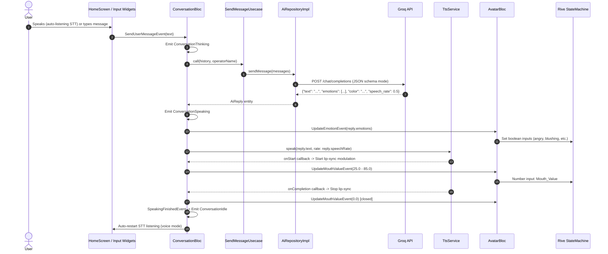

# Amadeus

> An interactive 2D AI companion inspired by the "Amadeus" system from *Steins;Gate 0*. Features a Rive-animated avatar that converses via voice or text, with vocal synthesis, dynamic lip-sync, and animations driven autonomously by the AI.


---

## 🎬 Demo


| Operator Onboarding | Voice & Text Terminal | Avatar Emotions | Visual Glitch Diagnostics |
| :---: | :---: | :---: | :---: |
|  |  |  |  |
| *Callsign registration* | *Dual-mode conversation* | *AI-driven expressions* | *Shader glitch on error* |

---

## 📖 Overview

Amadeus is a portfolio Flutter application that reconstructs the conversational AI assistant from the science-fiction visual novel *Steins;Gate 0*. Built with Clean Architecture and BLoC, the app features an animated Kurisu Makise 2D avatar controlled in real time by an LLM via the Groq API.

The system prompt strictly casts the AI into character—an articulate, slightly tsundere neuroscientist—and requires structured JSON output. The LLM autonomously dictates reply text, ambient theme colors, emotional gestures, and speech rates. An on-device Text-to-Speech (TTS) engine synthesizes her responses with natural female voice filtering, actively driving real-time procedural lip-sync movements on the Rive artboard.

### Key Features

- **Persona-Driven Conversational AI**: Connects to the Groq API (`openai/gpt-oss-20b`) with a system prompt enforcing Kurisu Makise's personality, speech patterns, and operator callsign awareness.
- **Autonomous Emotion & Cadence Dispatch**: The model returns JSON containing reply dialogue, emotion tags (`angry`, `blushing`, `handToChest`, `shakingHead`, `checkingOnUser`, `boring`), ambient glow hex colors, and dynamic speech rates (`speech_rate`).
- **Real-Time 2D Rive Avatar**: Unified state machine (`State Machine 2`) managing procedural breathing, eye blinks, hair sway, numeric mouth positions (`Mouth_Value`), and discrete emotional animations.
- **Natural Voice Synthesis (TTS)**: Clean-architecture TTS service leveraging `flutter_tts` tuned to Kurisu's persona (pitch `1.15`). Automatically filters and prioritizes cloud WaveNet voices on Android and enhanced/Siri voices on iOS.
- **Real-Time Lip-Sync Animation**: Synchronizes speech audio with avatar mouth movement by modulating `Mouth_Value` during speech playback and snapping to `0.0` (closed) on completion, cancellation, or interruption.
- **Continuous Auto-Listening (STT)**: Hands-free voice recognition loop via `speech_to_text` that pauses while Amadeus is thinking or speaking, and automatically resumes listening when vocalization completes.
- **Autonomous Idle Initiative**: Proactive 15-second idle timer that triggers character-accurate spoken nudges (e.g., checking on the operator or complaining of boredom) if the user goes silent.
- **Terminal UI & Diagnostics**: Cyberpunk CRT grid painter, telemetry diagnostic bars, custom glitch shader effects, and reactive ambient illumination.

---

## ⚙️ How It Works



1. User input is captured via `SpeechRecognizer` (continuous STT) or `HomeTextInputArea` (text) and dispatched to `ConversationBloc`.
2. `ConversationBloc` transitions to `ConversationThinking` and calls `SendMessageUsecase` with the rolling 20-message memory.
3. `AiRepositoryImpl` queries Groq's completions endpoint with a 15-second timeout, enforcing strict JSON containing text, emotions, color, and speech rate.
4. `GroqResponseMapper` deserializes the payload into an `AiReply` domain entity.
5. `ConversationBloc` emits `ConversationSpeaking`, triggers `UpdateEmotionEvent` on `AvatarBloc`, and invokes `TtsService.speak()`.
6. During playback, `ConversationBloc` modulates `Mouth_Value` on the Rive state machine at 110ms syllable intervals.
7. Upon completion or interruption, the mouth closes (`0.0`), `ConversationIdle` is emitted, and STT auto-restarts in voice mode.

---

## 🏛️ Architecture

The project adheres strictly to **Clean Architecture** organized with a **feature-first** structure:

```
lib/
├── core/                  # Cross-cutting concerns and shared dependencies
│   ├── constants/         # App keys, assets, emotion enums, interaction modes
│   ├── extensions/        # Helper extensions (e.g., spacing)
│   ├── routes/            # Declarative navigation with GoRouter
│   ├── services/          # Dependency injection (GetIt) and local storage (CacheHelper)
│   ├── theme/             # Cyberpunk palette and typography
│   ├── utils/             # Reusable UI alerts and snackbars
│   └── widgets/           # Terminal background, grid painters, glitch canvas
└── features/              # Self-contained business modules
    ├── ai/                # Groq data sources, prompt builders, AiReply entities
    ├── auth/              # Operator onboarding and callsign storage
    ├── avatar/            # Rive state machine controller, AvatarBloc, artboard view
    ├── home/              # ConversationBloc, dialogue bubble, mic & keyboard controls
    ├── speech/            # Speech-to-text recognition & TTS synthesis services
    └── splash/            # Application entry splash screen
```

<details>
<summary>📁 View complete folder tree</summary>

```
lib/
├── core
│   ├── constants
│   │   ├── app_keys.dart
│   │   ├── assets.dart
│   │   ├── avatar_emotion.dart
│   │   └── interaction_mode.dart
│   ├── errors
│   ├── extensions
│   │   └── spacing.dart
│   ├── network
│   ├── routes
│   │   └── app_routes.dart
│   ├── services
│   │   ├── cache_helper.dart
│   │   └── service_locator.dart
│   ├── theme
│   │   ├── app_colors.dart
│   │   └── app_theme.dart
│   ├── utils
│   │   └── custom_snackbar.dart
│   └── widgets
│       └── custom_background
│           ├── custom_background.dart
│           └── widgets
│               ├── glitch_painter.dart
│               └── grid_painter.dart
├── features
│   ├── ai
│   │   ├── data
│   │   │   ├── datasources
│   │   │   │   └── groq_datasource.dart
│   │   │   ├── models
│   │   │   │   ├── chat_message.dart
│   │   │   │   ├── choice_model.dart
│   │   │   │   ├── groq_response_mapper.dart
│   │   │   │   ├── groq_response_model.dart
│   │   │   │   ├── message_model.dart
│   │   │   └── usage_model.dart
│   │   │   └── repositories
│   │   │       └── ai_repository_impl.dart
│   │   └── domain
│   │       ├── entities
│   │       │   ├── ai_reply.dart
│   │       │   └── chat_message.dart
│   │       ├── prompts
│   │       │   └── amadeus_system_prompt.dart
│   │       ├── repositories
│   │       │   └── ai_repository.dart
│   │       └── usecases
│   │           └── send_message_usecase.dart
│   ├── auth
│   │   ├── data
│   │   │   ├── datasources
│   │   │   │   └── auth_local_data_source.dart
│   │   │   └── repositories
│   │   │       └── auth_repository_impl.dart
│   │   ├── domain
│   │   │   ├── repositories
│   │   │   │   └── auth_repository.dart
│   │   │   └── usecases
│   │   │       └── save_operator_name_usecase.dart
│   │   └── presentation
│   │       ├── bloc
│   │       │   ├── auth_bloc.dart
│   │       │   ├── auth_event.dart
│   │       │   └── auth_state.dart
│   │       ├── screens
│   │       │   └── auth_screen.dart
│   │       └── widgets
│   │           ├── amadeus_text_field.dart
│   │           ├── build_telemetry_header.dart
│   │           ├── cyber_button.dart
│   │           ├── cyber_panel.dart
│   │           ├── telemetry_header.dart
│   │           └── terminal_footer.dart
│   ├── avatar
│   │   ├── data
│   │   │   └── models
│   │   │       └── rive_input_names.dart
│   │   ├── domain
│   │   └── presentation
│   │       ├── avatar_bloc
│   │       │   ├── avatar_bloc.dart
│   │       │   ├── avatar_event.dart
│   │       │   └── avatar_state.dart
│   │       └── widgets
│   │           └── avatar_view.dart
│   ├── home
│   │   ├── data
│   │   ├── domain
│   │   └── presentation
│   │       ├── conversation_bloc
│   │       │   ├── conversation_bloc.dart
│   │       │   ├── conversation_event.dart
│   │       │   └── conversation_state.dart
│   │       ├── screens
│   │       │   └── home_screen.dart
│   │       └── widgets
│   │           ├── home_mic_button.dart
│   │           ├── home_speech_bubble.dart
│   │           └── home_text_input_area.dart
│   ├── speech
│   │   ├── data
│   │   │   ├── speech_recognizer_impl.dart
│   │   │   └── tts_service_impl.dart
│   │   └── domain
│   │       ├── speech_recognizer.dart
│   │       └── tts_service.dart
│   └── splash
│       └── presentation
│           └── screens
│               └── splash_screen.dart
├── main.dart
└── my_app.dart
```
</details>

### Architectural Highlights

- **Strict Domain Independence**: The `domain/` layer contains pure Dart abstractions (`SpeechRecognizer`, `TtsService`, `AiRepository`, `ChatMessage`, `AiReply`) with zero dependencies on concrete packages or the data layer.
- **Decoupled Dual-BLoC Design**: `AvatarBloc` (visual rendering state) and `ConversationBloc` (dialogue & lifecycle orchestration) remain distinct. `ConversationBloc` communicates with `AvatarBloc` through high-level event dispatching.
- **Concurrency Transformers**:
  - `droppable()` on `SendUserMessageEvent` ignores extraneous submit actions while an LLM round-trip is already in flight.
  - `restartable()` on `UpdateEmotionEvent` cancels ongoing 7-second neutral reset timers when new animations are triggered.
- **Single Source of Truth (`AvatarEmotion`)**: Enforces strict mutual exclusivity rules (e.g., `boring`, `checkingOnUser`, and `shakingHead` cannot conflict) while auto-generating prompt definitions and Rive bindings.

---

## 🛠️ Tech Stack

| Package | Version | Purpose |
| :--- | :--- | :--- |
| `flutter_bloc` | `^9.1.1` | Predictable state management across conversation and avatar lifecycles |
| `bloc_concurrency` | `^0.3.0` | Event transformers (`droppable`, `restartable`) for async flow control |
| `rive` | `^0.14.11` | 2D vector runtime animation controller and state machine execution |
| `flutter_tts` | `^4.2.5` | Text-to-speech synthesis with platform voice selection and lifecycle hooks |
| `speech_to_text` | `^7.4.0` | Continuous device speech recognition for voice interaction |
| `dio` | `^5.11.1` | HTTP networking client with configured 15-second request timeouts |
| `get_it` | `^9.2.1` | Compile-time dependency injection and service locator |
| `go_router` | `^17.5.0` | Declarative routing and deep navigation management |
| `shared_preferences` | `^2.5.5` | Local persistent storage for operator callsign and interaction modes |
| `flutter_dotenv` | `^6.0.1` | Environment variable management for API keys and endpoint URLs |
| `flutter_native_splash`| `^2.4.7` | Platform-native launch splash generation |
| `device_preview` | `^1.3.1` | Multi-screen responsiveness inspection tool |
| `cupertino_icons` | `^1.0.8` | Default iconography assets |

---

## 🚀 Getting Started

### Prerequisites

- Flutter SDK: `^3.11.5` / Flutter 3.24+ (Tested on Flutter `3.41.9` / Dart `3.11.5`)
- A working microphone (for Speech-to-Text input) and speakers/headphones (for TTS audio)
- A free Groq API Key from [console.groq.com](https://console.groq.com)

### Installation

1. **Clone the repository:**
   ```bash
   git clone https://github.com/<!-- TODO: USERNAME -->/amadeus_app.git
   cd amadeus_app
   ```

2. **Install dependencies:**
   ```bash
   flutter pub get
   ```

3. **Configure environment variables:**
   ```bash
   cp .env.example .env
   ```
   Open `.env` and supply your Groq credentials:
   ```env
   API=gsk_your_actual_groq_api_key_here
   API_URL=https://api.groq.com/openai/v1/chat/completions
   ```

   > [!WARNING]
   > The `.env` file is declared in `assets/` inside `pubspec.yaml` to allow runtime reading via `flutter_dotenv`. Bundling secrets in client binaries means API keys can be extracted from compiled releases. This setup is strictly suitable for local development, academic demos, and portfolio evaluation.

4. **Run the project:**
   ```bash
   # Run on connected device or desktop
   flutter run
   ```

*Platform Support*: Verified on Linux Desktop and Android <!-- TODO: add any other tested platforms -->.

---

## ⚙️ Configuration

| Variable | Description | Example / Default |
| :--- | :--- | :--- |
| `API` | Authentication bearer token for the Groq API | `gsk_...` |
| `API_URL` | Groq chat completions endpoint | `https://api.groq.com/openai/v1/chat/completions` |

---

## 🎨 Adding a New Avatar Emotion

Adding a new animated emotion requires four steps:

1. **Define the Rive input**: In your Rive artboard (`assets/rive/avatar_amadeus.riv`), add a new Boolean input inside `State Machine 2` (e.g. `is_confused`).
2. **Register the string identifier**: Open `lib/features/avatar/data/models/rive_input_names.dart`:
   ```dart
   static const String confused = 'is_confused';
   ```
3. **Add the enum definition**: In `lib/core/constants/avatar_emotion.dart`, add the emotion with its description:
   ```dart
   enum AvatarEmotion {
     // Existing definitions...
     confused(
       riveInput: RiveInputNames.confused,
       description: 'baffled, puzzled by illogical logic, or questioning nonsense',
     );
   }
   ```
4. **Update state mappings**: Add the boolean field to `AvatarState` and update `fromEmotions()`:
   ```dart
   isConfused: emotions.contains(AvatarEmotion.confused),
   ```
The AI system prompt (`AvatarEmotion.promptList`), conflict resolver (`AvatarEmotion.fromList`), and Rive bridge map will automatically propagate the new emotion.

---

## 🧪 Testing

- **Static Analysis**: Verified clean using `flutter analyze` with 0 compile errors and 0 critical warnings.
- **Unit & BLoC Tests**: Planned <!-- TODO: Add unit and bloc test suite -->. Existing placeholder test located in `test/widget_test.dart`.

---

## 🗺️ Roadmap

- [x] Operator onboarding and local preference persistence (`shared_preferences`)
- [x] Clean Architecture with feature-first BLoC state management
- [x] Dynamic 2D Rive artboard controlled via `State Machine 2`
- [x] Concurrency control via `droppable()` and `restartable()`
- [x] Speech-to-Text continuous auto-listening loop (`SpeechRecognizer`)
- [x] Groq LLM API integration with structured JSON response parsing
- [x] In-memory rolling conversation history (20 messages)
- [x] Text-to-Speech (TTS) voice synthesis with natural voice selection (`TtsService`)
- [x] LLM-controlled dynamic speech rate based on emotion (`0.3` - `0.75`)
- [x] Real-time syllable-based Rive lip-sync mouth animation (`Mouth_Value`)
- [x] Autonomous idle timeout nudge behaviors with audio vocalization


---

## ⚠️ Known Limitations

- **Client-Bundled Secrets**: The `.env` file is embedded as a bundle asset, which is unsafe for production deployment.
- **Session Memory Volatility**: Conversation history is maintained in RAM and resets when the app process terminates.
- **Third-Party Model Upstream**: Relies on Groq's hosted `openai/gpt-oss-20b` endpoint; API schema revisions or model deprecations require prompt updates.
- **Device-Dependent TTS Voices**: Voice naturalness depends on the availability of Google WaveNet network voices (Android) or enhanced Siri voices (iOS) installed on the target device.

---

## 📜 Credits & Legal Disclaimer

- **Non-Commercial Fan Project**: This application is a non-profit fan project created solely for software engineering study and portfolio demonstration. It is not affiliated with, endorsed by, or sponsored by MAGES., 5pb., Nitroplus, or any rights holders of *Steins;Gate*.
- **Trademarks & Copyrights**: *Steins;Gate*, *Amadeus*, and *Kurisu Makise* are trademarks and intellectual property of their respective creators and copyright owners.
- **Artwork License**: Source code in this repository is distributed under the MIT License. All original character artwork, illustrations, and 2D visual assets (`.riv`) remain the exclusive property of their respective creators and are excluded from the MIT license grant. <!-- TODO: Clarify if .riv asset is bundled or user-provided in repo -->

---

## 📄 License

The codebase of this project is licensed under the [MIT License](LICENSE).

---

## 👤 Author

**<!-- TODO: Mohamed Heiba -->**

- GitHub: [mohaaHeiba](https://github.com/mohaaHeiba)
- LinkedIn: [mohamed-heiba-141963325](https://linkedin.com/in/mohamed-heiba-141963325 )

